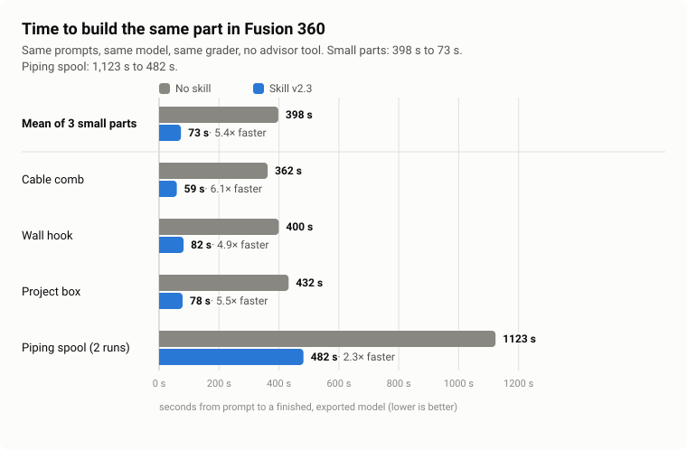
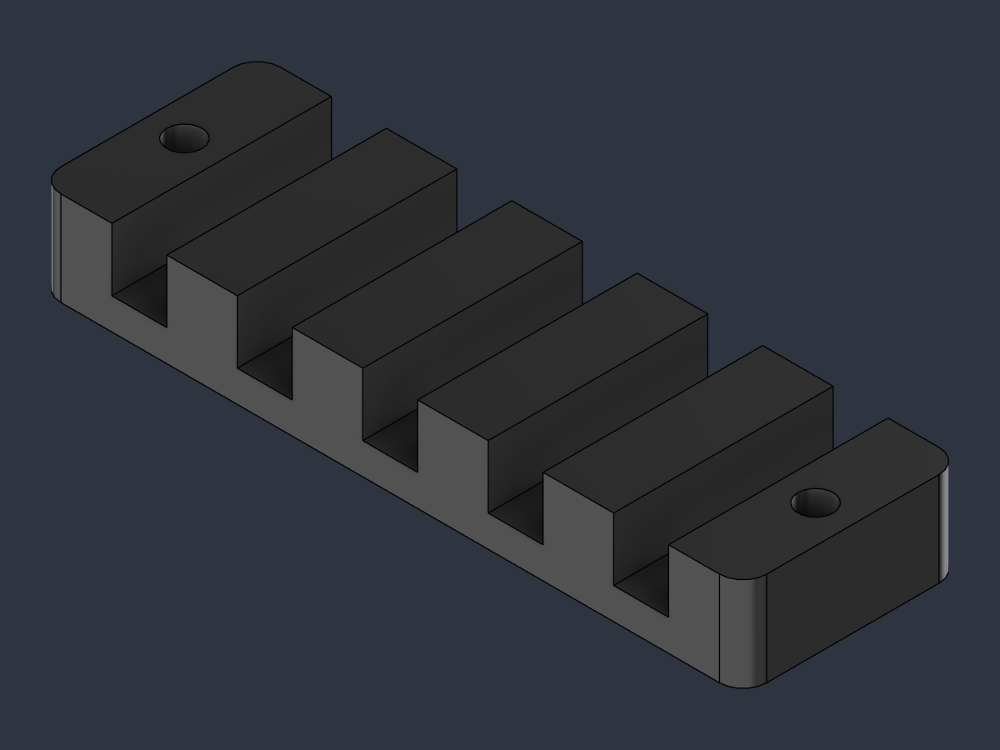
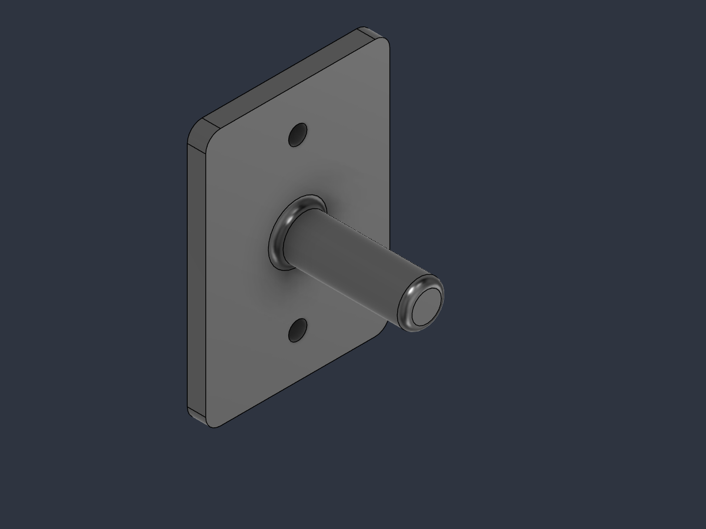
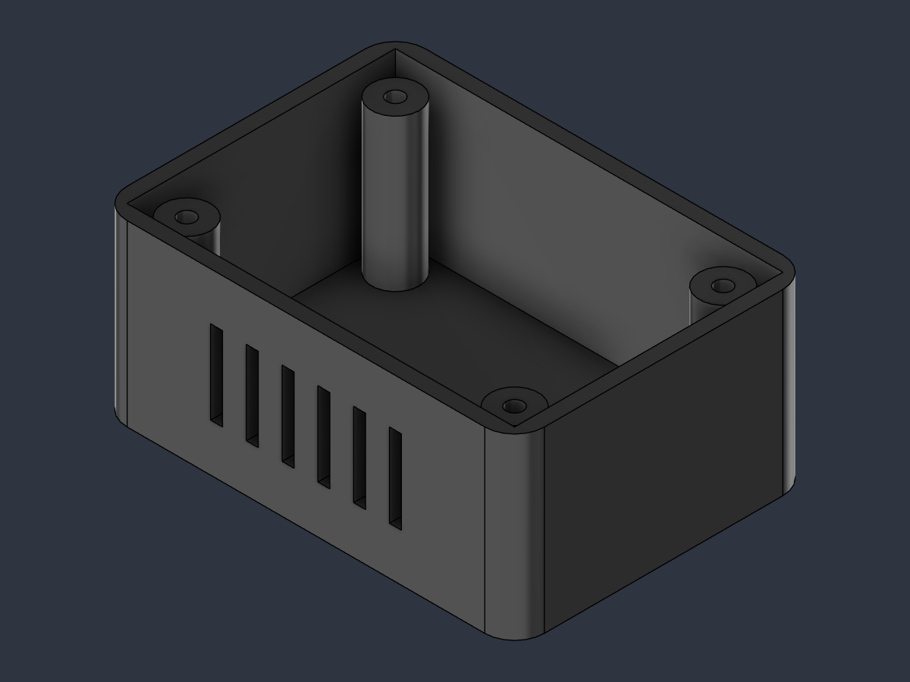

# Fusion Blitz: a Claude Code skill for faster Fusion 360 modelling


**Fusion Blitz** is an [Agent Skill](https://code.claude.com/docs/en/skills) for Claude Code (the skill itself is
called `fusion-fast-modeling`) that builds, edits and exports parametric models in **Autodesk Fusion 360** through
Fusion's built-in **MCP server**, the Model Context Protocol endpoint of the desktop app. It gives Claude a tested
Python helper for the Fusion API, a one-file build loop and numeric checkpoints, so an AI-assisted CAD session lands on
a correct, fully parametric part in a few script calls instead of a trial-and-error loop (1–4 calls per part with the
skill, 5–12 without, in the benchmark).

In a three-task benchmark, agents with the skill built the same parts in **124 s instead of 474 s (3.8× faster)**,
used **about 30 % fewer tokens**, and needed **7 Fusion script calls instead of 24** across the three tasks.



| Setup | Mean time | vs no skill | Mean tokens | Fusion script calls, 3 tasks (failed) | Checks passed, 3 tasks |
|---|---:|---:|---:|---:|---:|
| No skill | 474 s | – | 126,836 | 24 (5) | 36/39 |
| Skill v1 | 282 s | 1.7× faster | 104,409 | 7 (1) | 39/39 |
| **Skill v2 (this repo)** | **124 s** | **3.8× faster** | **89,394** | **7 (1)** | **39/39** |

Three tasks (cable comb, wall hook, project box), one run per task and setup, same prompts, same model (Claude
Sonnet 5.5), graded by script. **Read the caveats before you quote these numbers:** v2 was tuned on the same three tasks
after v1 was measured, so the untuned v1 (1.7×) is the cleaner comparison, and the tasks stay inside what the helper
wraps. Method, per-task results and every limitation are in [benchmarks/README.md](benchmarks/README.md).

## What you get

- **One build file, rebuilt from scratch.** The whole model is a `build()` in a `.py` file. When something fails you
  fix it with a small edit and run it again; nothing is re-sent in full and the file is the reproducible source of
  the model.
- **`fusion_fast`, a tested helper for the Fusion Python API** (`adsk.core` / `adsk.fusion`). It works in millimetres,
  in world coordinates and picks geometry by position, so Claude never has to think about centimetres, sketch axes or
  edge indexes.
- **Numeric checkpoints instead of screenshots.** After each stage `m.report(...)` checks bounding box, volume (0.2 %),
  body count, cylinder radii, feature health and sketch constraints, and fails in the same call, naming the stage.
- **Parametric by default.** The request becomes named user parameters and expressions, so the model stays editable in
  Fusion; `m.what_if(...)` proves the geometry follows them.
- **Safe next to your real work.** It only touches documents it created itself, never saves or closes yours, and warns
  if one of your documents changed while it ran.
- **Exports that are verified:** STEP, STL, native F3D and Z-up preview PNGs.

## Fusion 360 API problems it handles for you

Most of the time in AI-driven Fusion modelling goes to round trips and failed API calls, not to Fusion. These are the
traps the helper removes (details in [SKILL.md](skills/fusion-fast-modeling/SKILL.md)):

| What you see | Cause | What the skill does |
|---|---|---|
| `VCS_SKETCH_OVER_CONSTRAINTS` when two holes sit at the same height | two driving dimensions with the same value from the same origin | draws the geometry 0.013 mm off target and lets the dimension expression pull it exact |
| "no target body to cut" on a through-all cut | a one-sided `setAllExtent` cut fails once a join exists | cuts a long finite distance (1000 mm) instead |
| the extrusion fills the whole face | a sketch on a face has the face outline projected in | deletes the reference curves on creation |
| sizes off by 10× | Fusion stores lengths in cm and volumes in cm³ | every length you pass in is mm |
| sketch coordinates mirrored or swapped | sketch axes depend on the plane (on `yz`, x = −world Z) | you give world coordinates, the helper maps them |
| a second body appears | a `join` whose profile touches nothing | `expect_bodies=1` fails the checkpoint |
| the "iso" view shows the part on its side | the view cube assumes Y-up | explicit Z-up cameras for the preview images |
| lost edge references after patterns and fillets | history not regenerated | `m.settle(...)` |
| the STEP file looks ten times too small | Fusion declares `SI_UNIT(.CENTI.,.METRE.)` in its STEP output | nothing to fix; check an export by re-importing it |
| `Körper2`, `Ebene1`, `Unbenannt` | default names are localised | everything is addressed by names you give it |

## Quick start

**Requirements**

- Autodesk Fusion (desktop app, running). Tested with Fusion 2705.1.25 on Windows 11.
- Fusion's MCP server switched on under **Preferences > General > API**
  ([Autodesk's documentation](https://help.autodesk.com/view/fusion360/ENU/?guid=FMCP-OVERVIEW)). It accepts local
  connections only and needs no sign-in.
- Claude Code with that server registered under the name `fusion-local` (the skill refers to the tool
  `mcp__fusion-local__fusion_mcp_execute`). Use the port shown in Fusion's preferences; it was 27182 in the tested
  setup:

```bash
claude mcp add --transport http fusion-local http://127.0.0.1:27182/mcp
```

**Install the skill** (personal skills live in `~/.claude/skills/`, project skills in `.claude/skills/`)

```bash
git clone https://github.com/AIPris/fusion-blitz.git
mkdir -p ~/.claude/skills
cp -r fusion-blitz/skills/fusion-fast-modeling ~/.claude/skills/
```

```powershell
git clone https://github.com/AIPris/fusion-blitz.git
New-Item -ItemType Directory -Force "$HOME\.claude\skills" | Out-Null
Copy-Item -Recurse fusion-blitz\skills\fusion-fast-modeling "$HOME\.claude\skills\"
```

**Use it.** Open Claude Code and describe the part. The skill loads on its own when a request is about modelling in
Fusion, or call it with `/fusion-fast-modeling`:

> Model a wall hook in Fusion: a mounting plate 50 mm wide (x), 70 mm tall (z) and 5 mm thick (y), back face on y = 0.
> Two 5 mm holes along y at x = 25, z = 12 and z = 58. A round arm, 12 mm diameter and 35 mm long, out of the front
> face, centred at x = 25, z = 35. R4 plate corners, R2 on the arm tip and on the arm-plate joint.

Claude writes `build_<job>.py`, runs it in Fusion, fixes what the checkpoints flag, exports STEP, STL and F3D, and
leaves the finished document open and unsaved.

## Example results

The three benchmark parts, as built by Claude with the skill. Each part has a build script you can read in
[`examples/`](examples).

<table>
<tr>
<td align="center"><br><b>Cable comb</b><br>164 s with the skill, 298 s without<br><a href="examples/build_comb.py">build_comb.py</a></td>
<td align="center"><br><b>Wall hook</b><br>87 s with the skill, 410 s without<br><a href="examples/build_hook.py">build_hook.py</a></td>
<td align="center"><br><b>Project box</b><br>122 s with the skill, 713 s without<br><a href="examples/build_box.py">build_box.py</a></td>
</tr>
</table>

## How a build looks

A build is a short script of named parameters, features and checkpoints (adapted from
[`examples/build_comb.py`](examples/build_comb.py)):

```python
import fusion_fast as ff

m = ff.new("Cable_Comb", replace=True)
m.params(bar_len=90, bar_w=28, bar_h=12, slot_w=7, slot_d=8, slot_pitch=16, slot_count="5", corner_r=3)

base = m.sketch("xy", name="Bar")                       # coordinates are world (x, y), in mm
base.rect(0, 0, "bar_len", "bar_w")                     # strings are Fusion expressions, so the model stays parametric
m.extrude(base, "bar_h", body="Comb")
m.report("bar", expect_size=(90, 28, 12), expect_volume=90 * 28 * 12, expect_bodies=1)   # raises here, naming the stage, if off

m.fillet("Corner_Fillet", ("corner_r", m.edges(parallel="z", x=[0, 90], y=[0, 28])))
```

[`SKILL.md`](skills/fusion-fast-modeling/SKILL.md) has the full helper cheat sheet: sketches on world planes and faces,
extrude and cut, hole sets, rectangular and circular patterns, mirrors, sweeps along dimensioned routes, lofts,
revolves, construction axes, edge and face selection by position, fillets and chamfers, `report`, `probe`, `what_if`,
export and views.

## Limitations

- Tested on Windows 11 with Fusion 2705.1.25 and Claude Code only. The helper uses just the Fusion API, but other
  platforms are untested.
- It drives the **local desktop MCP server** (`fusion_mcp_execute` scripts), not Autodesk's cloud MCP servers.
- Wrapped: sketches, extrude, cut, holes, rectangular and circular patterns, mirror, sweep (with a dimensioned
  straight-and-arc route), loft, revolve, construction axes, fillets, chamfers, probes, export, views. Not wrapped:
  native threads and shell. For those, `SKILL.md` tells Claude to use the raw API inside the same build file and to
  finish with a checkpoint.
- The benchmark covers three simple parts. See [benchmarks/README.md](benchmarks/README.md) for what it does and does
  not show.
- Geometry checks do not prove strength, fit or printability. Review parts before you manufacture them.

## Repository layout

```text
skills/fusion-fast-modeling/    the skill: SKILL.md, scripts/fusion_fast.py (helper), scripts/example_build.py (template)
examples/                       build scripts and preview images produced with the skill in the benchmark
benchmarks/                     method, per-run results, chart, report script and the grading harness
```

Skill versions are tagged: `v1.0.0` is the first draft measured in benchmark iteration 1, `v2.0.0` is the iteration-2
version published here (plus one helper fix made during iteration 2, see the benchmark caveats).

## License

[MIT](LICENSE). Fusion 360 and Autodesk are trademarks of Autodesk, Inc. This project is independent and is not
affiliated with or endorsed by Autodesk or Anthropic.
