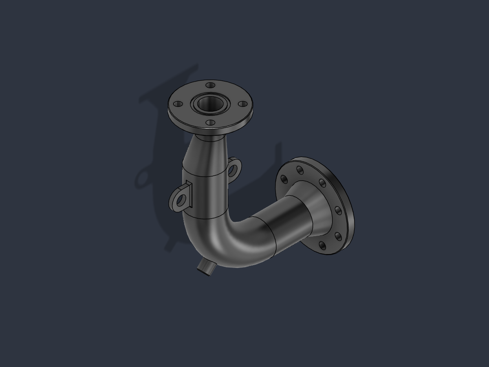

# Benchmarks: Fusion 360 modelling with and without the skill

The same modelling tasks were given to a fresh Claude agent with and without the skill. Every build ran through the
Fusion MCP on a real Fusion 360 desktop session and was graded afterwards by script, not by the agent's own report.
This page has the current results (skill v2.3, no advisor tool), the development log that led to them, the first
benchmark (v1 and v2, advisor tool allowed) and every caveat.


## Results: skill v2.3 against no skill, no advisor tool

| Setup | Mean time, 3 small parts | vs no skill | Mean tokens | Fusion script calls (failed) | Checks passed |
|---|---:|---:|---:|---:|---:|
| No skill | 398 s | – | 120,384 | 30 (13) | 36/39 |
| Skill v2.3 | 73 s | 5.4× faster | 78,023 | 5 (1) | 39/39 |

| Task | No skill | Skill v2.3 |
|---|---:|---:|
| Cable comb | 362 s, 7 calls (3 failed), 114k tokens | 59 s, 2 calls (1 failed), 76k tokens |
| Wall hook | 400 s, 12 calls (4 failed), 121k tokens | 82 s, 2 calls (0 failed), 80k tokens |
| Project box | 432 s, 11 calls (6 failed), 126k tokens | 78 s, 1 call (0 failed), 79k tokens |
| Piping spool | 1,123 s (887-1359), 29 calls in 2 runs (5 failed), 229k tokens | 482 s (448-516), 6 calls in 2 runs (1 failed), 162k tokens |

Cells are wall-clock time of the agent run (for the spool the mean of two runs with the range in brackets), the number
of `fusion_mcp_execute` script calls, and total tokens. Raw numbers per run are in [`runs/`](runs), aggregated in
[`results.json`](results.json). The agents were told not to call the advisor tool, and the transcript analysis shows no
advisor call in any of the ten runs.

What the numbers show, and what they do not:

- **Speed.** 5.4× on the three small parts (comb 6.1×, hook 4.9×, box 5.5×) and 2.3× on the spool. Against the faster of
  the two no-skill spool runs (887 s) the skill's mean is 1.8× faster.
- **Where the time goes.** On the spool both setups spend nearly all of the time with the model thinking (Fusion itself
  ran for 5 to 7 s per run). The skill runs made their first Fusion call after 426 s and 356 s, the no-skill runs after
  529 s and 645 s, and then needed 2 and 4 script calls against 13 and 16. Failed calls: none or one with the skill, 3
  and 2 without; one of the no-skill runs hit the `setByPlane` trap described below.
- **Quality.** Every skill run passed every check (39/39 on the small parts, 16/16 on both spool runs). So did both
  no-skill spool runs. The no-skill project box scored 10 of 13 because the agent added R2.5 fillets on the inside
  corners that the request did not ask for: valid geometry, but it fails the volume, radius and STEP checks. The same
  happened in the first benchmark.
- **Sample size.** One run per small part and setup, two for the spool. The two no-skill spool runs differ by 470 s, so
  the size of the spool's gap is uncertain even though its direction is not.

## Development log: the spool, with the advisor tool allowed

The spool (task 4) was the development task for skill versions 2.1 to 2.3. These runs allowed the agents an advisor
tool, a stronger reviewer model that a run may consult; one call took 30 to 300 s of pure waiting. That wait has
nothing to do with the skill and varies from run to run, so the tables give the wall time and the wall time without
the advisor waits (taken from the transcript timestamps). The final comparison above removes the advisor altogether.

Spool, one or two runs per row, all 16/16:

| Setup | Wall time | Without advisor waits | Tokens |
|---|---:|---:|---:|
| No skill | 921 s | 747 s | 172,222 |
| Skill v2 (iteration 3) | 1,407 s | 1,144 s | 253,904 |
| Skill v2.1 (iteration 4) | 965 s | 659 s | 178,791 |
| Skill v2.1 (iteration 5, control) | 786 s | 576 s | 175k |
| Skill v2.2 (iteration 5), runs 1 and 2 | 689 s and 728 s | 494 s and 595 s | 167k and 172k |
| Skill v2.3 (iteration 7), runs 1 and 2 | 756 s and 741 s | 434 s and 464 s | 155k and 164k |

What changed in each version, and why:

- **v2 against no skill was slower on this part** (1,407 s against 921 s). The skill told the agent to compute the
  expected volume of every stage by hand. The agent's build file held 13 such checks and about 55 lines of volume
  arithmetic, which probably explains the longer thinking (the thinking itself is not visible in the transcripts).
- **v2.1** wrapped what the spool needs and the first three tasks did not (sweep, loft, revolve, circular pattern,
  construction axes, a dimensioned path sketch) and read volumes at very high accuracy. Fusion calls on the spool fell
  from 7 to 2.
- **v2.2** dropped the expected volumes for stages without a one-line closed form (probes instead) and added rings and
  polygons.
- **v2.3** added `m.edges_between` (the seam edges where two joined features meet, which the agents had worked out by
  hand), made `report` print how much of each cut tool sat in material, and told the agent to probe only at coordinates
  the request states. The two runs that were fastest net of the advisor came with it, but the wall time did not improve
  because both runs spent 277 to 322 s waiting for the advisor. That is what led to the no-advisor comparison.

The three small tasks with the advisor tool allowed, one run each, wall time and wall time without the advisor waits
(comb / hook / box): v2.1 172 s, 276 s, 119 s and 122 s, 139 s, 119 s; v2.2 153 s, 164 s, 337 s and 73 s, 92 s, 144 s;
v2.3 196 s, 139 s, 238 s and 83 s, 87 s, 121 s. The box with v2.2 took 337 s of which 193 s were two advisor calls.
None of these runs lost a check.

## The first benchmark: v1 and v2, advisor tool allowed

The first measurement (iterations 1 and 2) compared no skill, skill v1 and skill v2 on the three small tasks, with an
advisor tool available. It is kept because the rest of this page grew out of it, not because its absolute numbers are
comparable with the ones above:

| Setup | Mean time, 3 small parts | vs no skill | Mean tokens | Fusion script calls (failed) | Checks passed |
|---|---:|---:|---:|---:|---:|
| No skill | 474 s | – | 126,836 | 24 (5) | 36/39 |
| Skill v1 | 282 s | 1.7× faster | 104,409 | 7 (1) | 39/39 |
| Skill v2 | 124 s | 3.8× faster | 89,394 | 7 (1) | 39/39 |

| Task | No skill | Skill v1 | Skill v2 |
|---|---:|---:|---:|
| Cable comb | 298 s, 5 calls (0 failed), 111k tokens | 208 s, 3 calls (1 failed), 98k tokens | 164 s, 4 calls (1 failed), 87k tokens |
| Wall hook | 410 s, 7 calls (1 failed), 116k tokens | 342 s, 2 calls (0 failed), 108k tokens | 87 s, 1 call (0 failed), 85k tokens |
| Project box | 713 s, 12 calls (4 failed), 154k tokens | 296 s, 2 calls (0 failed), 107k tokens | 122 s, 2 calls (0 failed), 96k tokens |

Speed-up over no skill: v1 1.4× / 1.2× / 2.4× and v2 1.8× / 4.7× / 5.8× on comb / hook / box. v2 was written after v1
was measured, using what those runs showed, and measured on the same three tasks, so its numbers are in-sample and the
untuned v1 (1.7×) is the cleaner comparison. Two of the 9 runs had no advisor call at all (v2 hook and box), which
flatters v2's 124 s: without the advisor waits the means are 341 s (no skill), 171 s (v1) and 104 s (v2).

## What was tested

Four parts, each described in plain language with exact dimensions; the fourth, the spool, is described under
[Task 4](#task-4-flanged-eccentric-elbow-spool).
The first three: The prompts are in
[`harness/driver.py`](harness/driver.py); the task text is repeated here.

<details>
<summary><b>Cable comb</b>: slots, through holes, rounded corners</summary>

Model a desk cable comb: a bar 90 mm long (x), 28 mm deep (y) and 12 mm tall (z) with one corner at the origin. Cut
five slots from the top, each 7 mm wide (x), running through the full depth (y) and 8 mm deep (z), pitch 16 mm, the set
of slots centred along the length. Two 4.5 mm mounting holes straight down through the whole bar at x = 4.75 mm and
x = 85.25 mm, y = 14 mm. Round the four vertical corner edges of the bar with R3.
</details>

<details>
<summary><b>Wall hook</b>: plate, holes, an arm on the front face, fillets on convex and concave edges</summary>

Model a wall hook: a mounting plate 50 mm wide (x), 70 mm tall (z) and 5 mm thick (y), with its back face on y = 0,
its bottom edge on z = 0 and x running from 0 to 50. Two 5 mm holes through the plate along y, at x = 25, z = 12 and at
x = 25, z = 58. A round hook arm, 12 mm diameter and 35 mm long, sticking out of the front face (y = 5, toward +y),
centred at x = 25, z = 35. Round the four plate corners (the edges parallel to y) with R4, the free end of the arm with
R2, and the joint between arm and plate with R2.
</details>

<details>
<summary><b>Project box</b>: shell by cut, posts, blind pilot holes, a slot pattern in one wall, rounded corners</summary>

Model a small project box with an open top. Outside size 70 mm (x) by 50 mm (y) by 30 mm (z), one corner at the origin,
2.5 mm walls and a 2.5 mm floor. Four round screw posts, 8 mm diameter, rising from the floor to z = 28 mm, centred
7.5 mm in from the outside faces in both x and y at each corner, i.e. at (7.5, 7.5), (62.5, 7.5), (7.5, 42.5) and
(62.5, 42.5); each post has a 2.8 mm pilot hole, 12 mm deep from the post top. Six ventilation slots, 2 mm wide (x) and
14 mm tall (z), cut through the front wall only (the wall at y = 0), the bottom of the slots at z = 8 mm, pitch 6 mm,
the set centred along x. Round the four vertical outside corner edges of the box with R5.
</details>

## How the runs were made

- **Agent:** Claude Sonnet 5.5 (`claude-sonnet-5-5`) at `xhigh` effort, started as a fresh Claude Code subagent per
  run. Both setups had the same tools (the Fusion MCP and file access). The skill setups were told to read `SKILL.md`
  first; the no-skill setup was not.
- **No advisor tool in the current results.** The prompt ends the ground rules with "Do not call the advisor tool"
  (`driver.py --no-advisor`). The tool was still present, so this is an instruction and not a removal; the transcripts
  of all ten runs show no call. The first benchmark and the development log did not have this line.
- **Same instructions:** the prompt asks for millimetres, Z up, every key dimension a named user parameter, fully
  constrained sketches, healthy features, one solid body, and STEP, STL, F3D and a preview PNG. The agent cannot ask
  questions and has to leave one new document open and unsaved.
- **One agent at a time.** Fusion has a single active document, so runs cannot overlap. In the current results the
  setups alternate (no skill, skill, no skill, skill for the spool; no skill then skill for each small part), and each
  skill run reads a frozen copy of the skill, with the installed copy moved away, so nothing can change mid-run.
- **Environment:** Windows 11, Fusion 2705.1.25 with its built-in MCP server, restarted before the current results so
  that only an empty document was open. After every run the harness fingerprints all open documents (name, flags,
  feature, body, sketch and parameter counts) and compares them with the state before, closes the benchmark document,
  and clears what Fusion's long-lived Python keeps between calls (module search path, imported modules, globals), so
  an earlier agent's files cannot be imported by a later one. Each transcript is audited for reads outside the allowed
  folders and for use of the Skill tool.
- **Time and tokens** are what Claude Code reported for the agent run (`timing.json`): total wall-clock seconds
  including reading the skill, and total tokens. **Fusion calls** are counted from the agent's transcript with
  [`harness/transcript_stats.py`](harness/transcript_stats.py); a call counts as failed when the tool result is
  flagged as an error or the MCP result says `"success": false`. Advisor waits in the development log are the gaps
  between the advisor request and its answer in the transcript.

## How the runs were graded

[`harness/grade.py`](harness/grade.py) runs inside Fusion, read-only, against the finished document, and
[`harness/step_check.py`](harness/step_check.py) re-imports the delivered STEP file with build123d. Thirteen checks per run:

1. the document exists and was left open
2. exactly one solid body
3. bounding-box size matches the request (±0.05 mm)
4. the part sits where requested (bounding-box minimum corner, ±0.05 mm)
5. volume within 0.2 % of the reference model
6. cylindrical faces (holes, posts, fillets) match the reference by radius
7. every timeline feature is healthy
8. every sketch is fully constrained
9. at least N named user parameters
10. at least half of the sketch dimensions are driven by named parameters
11. STEP, STL, F3D and the preview PNG were delivered and are not empty
12. the other documents open in Fusion are unchanged
13. the delivered STEP re-imports as one valid solid with the reference size, position and volume

The reference volumes and radii of tasks 1 to 3 come from [`harness/golden.py`](harness/golden.py), which builds each part
once with the helper; task 4 has an independent reference, see below. The per-run results, including the evidence string
for every check, are in `runs/<task>/<setup>/grading.json`.

## Task 4: flanged eccentric elbow spool

The first three tasks stay inside what the helper wraps. This one does not. It is a 90 degree piping spool with an inlet
and an outlet flange, an eccentric reducer, a sensor boss at 45 degrees on the bend, four gusset ribs and two lifting
lugs. The Fusion build has 27 features on 25 sketches (17 extrudes, 3 lofts, 2 revolves, 3 chamfers, one fillet loop and
one circular pattern), plus 26 construction planes, 3 construction axes and 45 named user parameters.

Revolve, loft, construction axes, an angled work plane and the circular pattern were not wrapped by `fusion_fast` v2, so
this was the task that exercised the skill's fallback to the raw API (`m.root`, `m.design`); v2.1 wraps all of them
except the angled plane. One trap on the way: in a
parametric design Fusion refuses a work plane made with `setByPlane` (direct modelling only), so the tilted plane for
the boss has to be built from two offset planes, an axis and an angle.



<details>
<summary>The task text, 734 words (exactly what the agent is given)</summary>

Model a flanged eccentric reducing elbow (a piping spool) as one solid body. Millimetres, Z up. The centreline lies in the XZ plane (y = 0) except for the offset of the outlet. The inlet face is the plane x = 0 and the centreline starts at the origin.

Pipe: the main pipe is 88.9 mm outside diameter with a 78.9 mm bore (5 mm wall); the reduced pipe is 60.3 mm outside diameter with a 50.3 mm bore. The bore runs clear from the inlet face to the outlet face and nothing (boss, ribs, lugs) intrudes into it.

Centreline, in order: (1) straight along +X from x = 0 to x = 160; (2) a 90 degree bend of radius 150 turning towards +Z, arc centre (160, 0, 150), from (160, 0, 0) to (310, 0, 150); (3) straight along +Z at x = 310 from z = 150 to z = 250; (4) an eccentric reducer from z = 250 to z = 330: a straight-sided (ruled, no guide rails) transition from the 88.9 mm circle centred on x = 310, y = 0 to the 60.3 mm circle centred on x = 310, y = 14.3, so the outer surfaces line up along the +Y side; the bore makes the same transition from 78.9 mm to 50.3 mm with the same two circle centres; (5) straight along +Z at x = 310, y = 14.3 from z = 330 to z = 398, which is the outlet face.

Inlet flange (axis along X): a disc of 200 mm diameter, 20 mm thick (x = 0 to 20), with 8 holes of 18 mm diameter on a 160 mm bolt circle at 22.5 + k * 45 degrees measured from +Z in the YZ plane; an annular groove in the x = 0 face, 104 mm inner and 114 mm outer diameter, 3 mm deep; a conical weld-neck hub from 116 mm diameter at x = 20 to the 88.9 mm pipe diameter at x = 60; 1.5 mm x 45 degree chamfers on both outer edges of the disc.

Outlet flange (axis along Z through x = 310, y = 14.3): a disc of 165 mm diameter, 18 mm thick (z = 380 to 398), with 4 holes of 18 mm diameter on a 125 mm bolt circle at 45 + k * 90 degrees measured from +X in the XY plane; an annular groove in the z = 398 face, 66 mm inner and 78 mm outer diameter, 2.5 mm deep; 1.5 mm x 45 degree chamfers on both outer edges of the disc. Four gusset ribs under the disc, each an 8 mm thick right triangle lying in a plane that contains the outlet axis, at 0, 90, 180 and 270 degrees (parallel to the XZ and YZ planes): the right angle is 28 mm from the outlet axis (inside the pipe wall, so the rib fuses with it) on the underside of the disc (z = 380), one leg runs 32 mm outwards along the underside (to 60 mm from the axis), the other runs 40 mm down along the pipe (to z = 340).

Sensor boss: a 30 mm diameter cylinder whose axis passes through the centreline point of the bend at 45 degrees, (266.066, 0, 43.934), and points radially away from the bend centre, direction (0.7071, 0, -0.7071). It runs from that centreline point out to 70 mm along its axis, with a 1.5 mm x 45 degree chamfer on the edge of its free end. A 12 mm diameter hole along the axis from the free end down to 30 mm from the centreline point opens into the bore.

Lifting lugs: two 10 mm thick plates (y = -5 to +5) on the vertical run, in the XZ plane, z = 175 to 225, from x = 240 to x = 380 (they pass through the pipe axis), each end finished with a semicircle of radius 25 centred at (380, 200) and (240, 200), so the plates reach x = 215 and x = 405. A 25 mm diameter hole through each plate at those centres. Where the plates meet the outside of the pipe they are blended with 4 mm fillets along the whole junction (both flat faces and the top and bottom faces).

Add nothing else: no other fillets, chamfers, threads or welds.
</details>

**The expected values come from two independent routes.** [`reference_spool.py`](harness/reference_spool.py) builds the
part with build123d (OpenCascade); no Fusion and no skill helper are involved. [`golden_spool.py`](harness/golden_spool.py)
builds it in Fusion with the helper plus raw API calls. They agree:

| | build123d reference | Fusion golden build |
|---|---:|---:|
| Volume | 1,719,679.341 mm³ | 1,719,673.142 mm³ (3.6 ppm lower) |
| Surface area | 446,803.17 mm² | 446,800.40 mm² |
| Centre of mass | (179.489, 3.562, 129.911) | (179.488, 3.562, 129.911) |
| Bounding box | 405 × 200 × 498 from (0, -100, -100) | the same |
| Faces | 77 | 77 |
| Cylinder radii | 16 distinct values | the same 16 |

**How task 4 is graded.** The same 13 checks as the other tasks, with four additions. All new keys are optional, so
tasks 1 to 3 are graded as before, apart from the volume accuracy noted below.

- Volume is checked at two levels: within 0.1 % (the part is roughly right) and within 0.005 % (every feature is there;
  the 1.5 mm chamfer on the boss alone is 0.006 %).
- The set of cylindrical-face radii replaces the face counts, because a kernel may split one cylinder into one or two
  faces.
- The centre of mass must be within 0.1 mm of the reference.
- 142 probe points (65 that must be solid, 77 that must be empty) sit either side of
  every hole, groove, wall, rib, lug and chamfer edge ([`spool_probes.py`](harness/spool_probes.py)). A feature in the wrong
  place or of the wrong size fails here even when volume and centre of mass cannot tell. The reference and the Fusion
  build classify every probe the same way, and none lies within 0.2 mm of a surface.

That makes 15 checks inside Fusion plus the STEP re-import, 16 in total. To see whether the grader discriminates, the
golden build was broken in seven ways, one parameter each, and graded again:

| Change to the golden model | Checks passed | Failing checks |
|---|---:|---|
| none | 15/15 | – |
| reducer offset flipped to the -Y side | 13/15 | centre of mass, probes |
| all chamfers 1.0 instead of 1.5 mm | 14/15 | strict volume (0.086 % off) |
| inlet bolt circle 150 instead of 160 mm | 14/15 | probes |
| lug holes 22 instead of 25 mm diameter | 10/15 | both volume checks, radius set, centre of mass, probes |
| ribs 6 instead of 8 mm thick | 11/15 | both volume checks, centre of mass, probes |
| outlet groove 3 instead of 2.5 mm deep | 12/15 | strict volume, centre of mass, probes |
| boss hole stops short of the bore | 13/15 | strict volume, probes |

(Before the probes sat at the hole edges, the bolt-circle change passed all checks: volume and centre of mass do not
change when a symmetric hole circle is resized. Probes at the hole centres alone did not catch it either.)

Design notes for anyone extending this:

- **Fusion's `body.volume` is 0.086 % low on this part** (1,718,202.84 mm³ against 1,719,673.14 mm³ from
  `getPhysicalProperties` at very high accuracy), which would fail a perfect model against the strict tolerance.
  `grade.py` and `golden.py` now read the very-high-accuracy volume. The first three tasks were graded with `body.volume`
  before this change; rebuilding their golden models shows the two accuracies agree to better than 0.01 ppm on those
  simple parts (and match the stored references within 0.02 ppm), so their grading is unchanged. The helper's own
  `report` read `body.volume` in v2, where its default 0.2 % tolerance absorbed the difference; v2.1 reads the
  very-high-accuracy volume too.
- **The STEP re-import is 0.06 % larger than Fusion's own volume** for this part, so `step_check.py` keeps its 0.2 %
  tolerance and the strict comparisons stay inside Fusion.
- **A boolean comparison of two STEP solids was tried and dropped.** OpenCascade returns garbled pieces (even negative
  volumes) when two nearly identical solids share almost all their faces.
- **The OpenCascade reference needed two workarounds.** The bore tools abut each other and must be fused into one tool
  (cutting them separately in one boolean loses about 100 mm³), and the finished solid is flagged invalid at the hole and
  bore intersection until `fix()` has run; the volume is identical before and after.

**What the runs showed.** The questions this task was added for, answered with two runs per setup (no advisor tool):

- *Does the skill's lead survive when the helper covers only part of the work?* It shrank, from 5.4× on the small parts
  to 2.3×, and it took several skill versions to get there: v2 was slower than no skill (see the development log). With
  v2.3 the helper wraps nearly everything the spool needs (sweep, loft, revolve, circular pattern, axes, a path sketch,
  seam edges): one skill build used no raw API call at all, the other seven lines for a tangent-arc outline.
- *How many Fusion calls?* 2 and 4 script calls with the skill, 13 and 16 without. The no-skill runs spent their calls on
  failed builds (3 and 2), API lookups and verification passes, and on 476 hand-written probe points in one run.
- *Does the tilted work plane trip both setups?* In the no-skill runs, one agent hit it and one avoided it: run 1 called
  `setByPlane` and got "Environment is not supported", run 2 built the plane with `setByAngle` straight away. The skill
  runs never needed an angled plane (the boss is a revolve in the XZ plane, since its axis lies in y = 0).

## Caveats

Please read these before you quote the numbers.

- **Small sample.** One run per small part and setup, two per setup for the spool, none repeated beyond that. The
  spread you can see is between tasks (the speed-up ranges from 2.3× to 6.1×) and between the two no-skill spool runs
  (887 s and 1,359 s). The mean of a few runs is not a confidence interval.
- **The skill was developed against these tasks.** v2 was rewritten after v1 was measured on the three small parts, and
  v2.1 to v2.3 were developed on the spool and its transcripts. The numbers are therefore in-sample. Expect less on
  parts the skill has never seen.
- **The advisor line is an instruction, not a removal.** The tool was present in every run; the prompt told the agents
  not to use it and the transcripts show none did. An earlier measurement with the tool available is in the
  development log, where it moves a single run's wall time by up to 322 s.
- **The tasks cover little.** Extrude, cut, holes, patterns, fillets, chamfers, and for the spool sweep, loft and
  revolve. Shell, threads and angled work planes are not wrapped and were not tested.
- **The no-skill pass rate (36/39 on the small parts) is one run.** In the project box the no-skill agent added R2.5
  fillets on the inside corners that the request did not ask for, in the first benchmark and again now. The geometry is
  valid, but it fails three checks (volume, cylinder radii, STEP volume). On the comb and the hook the no-skill agents
  matched the reference exactly.
- **The grading references were built with the helper** (tasks 1 to 3; the spool also has an independent build123d
  reference). They are plain geometry (volume, bounding box, radii, probe points), and the no-skill agents matched them
  exactly in most runs, which argues against a bias toward the skill. It is still a point to keep in mind.
- **Agents can have side effects.** One no-skill spool agent switched Fusion's default modelling orientation to Z-up for
  a moment and restored it. The harness checks the open documents, not the preferences.
- **One run was lost and redone.** The no-skill box run of the current comparison was cut off by the account's
  usage limit; it was discarded, the Fusion document it had left was closed, and the run was repeated from scratch.
- **The original runs also allowed reading a local folder of example Fusion scripts**, identical for both setups. The
  published driver leaves that sentence out, so a re-run starts from a slightly less helpful baseline.
- **v2's first benchmark contained one helper bug that has since been fixed.** The v2 comb run crashed on
  `ff.new(replace=True)` because of a stale registry entry for a document that had been closed outside the helper. The
  fix landed before the hook and box runs; the comb build script still contains its workaround.
- **Time is wall-clock time.** It includes model latency and Fusion's own time, and it moves with load on the machine.

## Reproduce it

You need Fusion running with its MCP server enabled, Claude Code with the `fusion-local` server registered, and `uv`
(for the STEP re-import). The harness is plain Python.

1. Inside Fusion (for example through `fusion_mcp_execute`, with `benchmarks/harness` on `sys.path`) call
   `grade.snapshot(r"<dir>/docs_before.json")` to record the documents that are open now.
2. `python benchmarks/harness/driver.py 1 <bench_dir> <dir>/docs_before.json --no-advisor` writes a prompt and a grading
   spec for every task (four, including the spool) and setup into `<bench_dir>/iteration-1/`. Leave `--no-advisor` out to
   allow the advisor tool as in the first benchmark.
3. Run each `prompt.txt` in a fresh Claude Code subagent, one at a time, and alternate the setups. Keep the skill that
   the no-skill setup must not see out of `~/.claude/skills/` while it runs.
4. After each run, grade the document inside Fusion with `grade.grade(r"<run_dir>/spec.json")`, then
   `uv run --python 3.12 --with build123d-mcp==0.3.91 python benchmarks/harness/step_check.py <run_dir>`, then
   `python benchmarks/harness/transcript_stats.py <agent_transcript.jsonl> <run_dir>/metrics.json`. Close the benchmark
   document with `grade.close_named("ZZ_bench_...")`; never use the MCP document-close action. Also compare the open
   documents with their state before the run.
5. Copy `timing.json`, `metrics.json` and `grading.json` of each run into `benchmarks/runs/<task>/<setup>/run-<n>/` and
   run `python benchmarks/report.py` to rebuild `results.json`, the chart and the tables. `report.py` reads the setups
   listed in its `EXPERIMENTS`.

To regenerate the task 4 reference and re-check its probe points:
`uv run --python 3.12 --with build123d-mcp==0.3.91 python benchmarks/harness/reference_spool.py --probes`.

To rebuild the task 4 golden model in Fusion, run this through `fusion_mcp_execute`. It builds the part in a scratch
document called `ZZ_golden_spool`, runs the checkpoints and exports STEP, STL, F3D and preview images:

```python
import sys
for p in (r"<repo>/skills/fusion-fast-modeling/scripts", r"<repo>/benchmarks/harness"):
    if p not in sys.path:
        sys.path.insert(0, p)
import golden_spool

def run(_context: str):
    golden_spool.build(r"<out_dir>")
```

## What is in this folder

| Path | Content |
|---|---|
| `runs/<task>/<setup>/[run-<n>/]` | `timing.json`, `metrics.json` and `grading.json` of every run in the two comparisons above, copied unchanged from the benchmark workspace (`*-noadvisor` setups: the current results; `no-skill`, `skill-v1`, `skill-v2`: the first benchmark) |
| `results.json`, `time-per-task.svg` | aggregated results and the chart, both generated by `report.py` |
| `report.py` | aggregation, chart and the tables above; standard library only |
| `harness/` | `driver.py` (tasks, prompts, grading specs), `grade.py` and `golden.py` (run inside Fusion), `step_check.py`, `transcript_stats.py` |
| `harness/reference_spool.py`, `golden_spool.py`, `spool_probes.py` | task 4: the build123d reference, the Fusion golden build, and the grader's probe points |
| `spool-reference.png` | the task 4 part as built in Fusion |

The generated CAD files, the raw agent prompts and the transcripts are not included. They embed local file paths and
the names of unrelated open documents. The development-log runs are summarised in the tables above but their raw files
are not included. The three preview images in [`../examples/`](../examples) come from the v2 runs.
